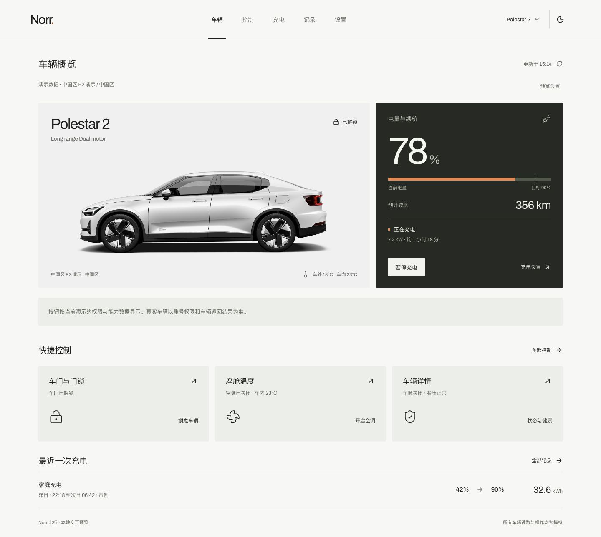

# Norr 北行

面向 Polestar 车主的车辆管理应用，采用极星风格的界面，提供车辆状态、远程控制、充电管理和本地历史。当前原生服务支持中国区 Polestar 2，Polestar 4 已提供外观素材，车辆服务接入待完成。

当前各平台状态、实施记录、测试包与待办汇总在[开发进展](docs/PROGRESS.md)。

macOS 版本使用 React + TypeScript、Tauri 2 和 Rust 本地车辆核心，已接通中国区 Polestar 2 的本机会话恢复、续期及 14 类车辆读取，并加入日程、后台采集、菜单栏、历史分析、备份恢复、登录启动、系统通知及免 Key 高德地图。Hisingen 会话与历史导入仅用于开发测试。浏览器入口提供完整交互预览，原生入口展示厂商读数。车辆写入的实车验证与其他平台迁移范围见原生宿主说明。

release 已接入中国大陆手机号登录、官方滑块验证、短信验证码、本机凭据保存及已有 Norr 会话恢复与续期。Android 真实短信登录和重启恢复已通过，macOS、Windows 与 iOS 的新账号短信端到端仍待测试。Hisingen 导入入口限定在 macOS 开发环境。详情见[开发进展](docs/PROGRESS.md)。

Windows 10/11 x64 测试包已完成交叉编译，复用现有界面与车辆核心，接入 WebView2 短信登录、Windows 账户加密存储及桌面系统功能。安装运行和真实短信登录待车友验证。构建方式与测试步骤见 [Windows 测试版](apps/native/README.md#windows-测试版)。

Android ARM64 测试包已在 Android 16 手机上完成真实短信登录、P2 读取与关闭后会话恢复。接入短信验证 WebView、Keystore、系统通知和文件选择器，自动采集在应用前台运行。最新包包含共享账号控制修复、橙色运行状态、高德地图默认展示、指令局部回读及控制页布局修复，已覆盖安装并核对 APK 摘要。最新自动刷新效果与车窗、尾门实车动作待反馈。构建与适配范围见 [Android 测试版](apps/native/README.md#android-测试版)。

iOS ARM64 模拟器包已在 iPhone 17 / iOS 27.2 上安装并启动，完成首次安装登录入口、浅深主题与安全区检查。共享账号的 P2 会话在覆盖安装后恢复，14 类读取成功。空调控制权限判断已修正，用户执行开启空调后，厂商完成回执与车辆运行状态回读均通过。短信流程现场复核、其他车控和实体 iPhone 验证待完成。构建与安装方式见 [iOS 模拟器版](apps/native/README.md#ios-模拟器版)。



## 本地运行

使用 Node.js 22.12 或更新版本。安装了 nvm 时，可先运行 `nvm use`。

在仓库根目录执行以下命令。

```sh
npm ci
npm run dev
```

开发服务默认地址为 `http://127.0.0.1:5173`。启动前检查端口占用。

```sh
lsof -nP -iTCP:5173 -sTCP:LISTEN
```

端口已占用时，可指定其他空闲端口。

```sh
npm run dev -- --port 5174
```

## 常用命令

| 命令 | 用途 |
| --- | --- |
| `npm run dev` | 启动共用前端 |
| `npm run typecheck` | 检查 TypeScript 类型 |
| `npm run build` | 类型检查并生成 `apps/web/dist` |
| `npm run preview` | 预览已构建的前端 |
| `npm run dev:mac` | 启动 macOS 原生开发窗口，使用 1420 端口 |
| `npm run build:mac` | 构建 `target/release/bundle/macos/Norr.app` |
| `npm run build:windows` | 构建 Windows x64 NSIS 安装包 |
| `npm run build:android` | 构建 Android ARM64 APK |
| `npm run build:ios` | 构建 iOS ARM64 模拟器应用 |
| `npm run check:native` | 运行 Rust 核心与宿主回归测试 |

依赖由根目录 `package-lock.json` 统一锁定。

原生应用构建使用 Rust 工具链和各平台 SDK。中国区登录配置通过 `NORR_POLESTAR_CN_SIGNING_KEY` 环境变量或根目录 `.env.secrets` 提供，平台签名配置按宿主说明设置。仓库忽略本地配置、签名文件、调试快照和构建产物。GitHub Actions 检查 PR 和主分支代码更新，每天北京时间 03:20 检查尚未发布的提交，有更新时构建四端并发布 alpha 预发行版。[下载安装包](https://github.com/pepsing/Norr/releases) · [构建说明](apps/native/README.md#github-actions)

## 反馈问题

问题反馈表单收集版本、平台、复现步骤与预期结果。车控问题可以补充服务回执和独立回读，帮助排查权限与刷新时序。维护者可将 issue 交给本地 Codex 或 Codex Cloud 修复并提交 PR。[提交问题](https://github.com/pepsing/Norr/issues/new/choose) · [参与开发](CONTRIBUTING.md)

## 目录与实现状态

| 路径 | 内容与状态 |
| --- | --- |
| `apps/web/` | 可运行的共用 React 界面、演示状态与车型素材 |
| `apps/native/` | macOS、Windows、Android 与 iOS Tauri 2 宿主、系统能力与指令记录 |
| `apps/harmonyos/` | ArkTS + ArkWeb 宿主位置，已写入接入说明，工程待实现 |
| `crates/vehicle-core/` | 中国区会话续期、服务发现、REST/gRPC、数据解码与核心指令 |
| `docs/research/` | 技术栈与极星视觉研究 |
| `docs/preview/` | 已完成界面的截图 |
| `licenses/` | 随项目保留的字体与图标许可 |

## 浏览器交互预览

- 车库、车型与外观选择，内置 Polestar 2 / 4 的 176 张官方来源图片。
- 车辆概览、空调与车身控制、能力与账号权限提示。
- 充电状态、计划、地点、费用与优化演示。
- 行程与充电记录、导出、备份恢复和隐私设置。
- 服务处理进度、独立回读结果和定时读取状态。
- 手机与桌面布局，浅色与深色主题。

中国区 Polestar 2 的核心控制和定时可在演示中操作。中国区 Polestar 4 的 HUANFU / Geely 原生服务仍待接入。Norr 原生厂商接入的实测结果与后续验证条件见[开发进展](docs/PROGRESS.md)。

## 开发资料

- [开发进展与待办](docs/PROGRESS.md)
- [界面范围与既有验证记录](apps/web/README.md)
- [原生各端构建、会话恢复与实车验证范围](apps/native/README.md)
- [已确认的设计方向](DESIGN.md)
- [技术栈研究](docs/research/web-pwa-native-stack-2026-11-12.md)
- [极星视觉研究](docs/research/polestar-visual-direction-2026-11-12.md)
- [研究记录的迁入说明](docs/research/README.md)
- [车型素材清单与来源](apps/web/public/images/vehicles/README.md)

## 来源与许可

初始界面从 Hisingen 工作区迁入，随项目保留其 MIT 许可与版权声明。第三方字体、图标和车辆图片各有对应的权利说明。

Polestar 图片的公开分发授权状态仍待确认，来源及文件摘要已记录在素材清单中。[代码许可](LICENSE) · [第三方说明](THIRD_PARTY_NOTICES.md)

## 独立工程初始化验证

- Hard Gate PASS。浏览器首页与车型图片正常加载，控制台错误列表为空。图片许可状态在素材说明中标明。
- Purpose Gate PASS。目录按共用界面、平台宿主和车辆核心职责组织，每个预留目录记录接入范围。
- Liveliness PASS。界面源码与已确认的 Norr 预览逐文件一致，使用 ENERGY 2 / RHYTHM 2 / MOTION 1。
- Craftsmanship PASS。独立执行 `npm ci` 和 `npm run build` 成功，176 张车型图片的 SHA-256 与大小校验通过，10 份迁入或新增文档的本地链接有效，77 个原锁文件依赖项的版本与摘要一致。
