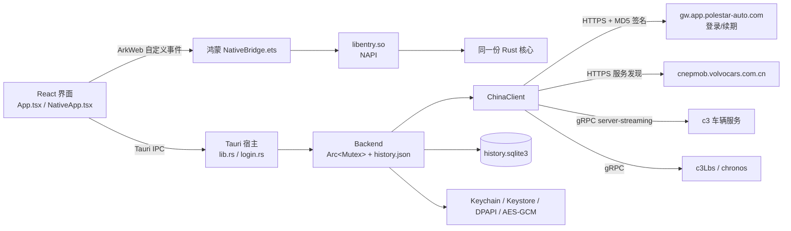
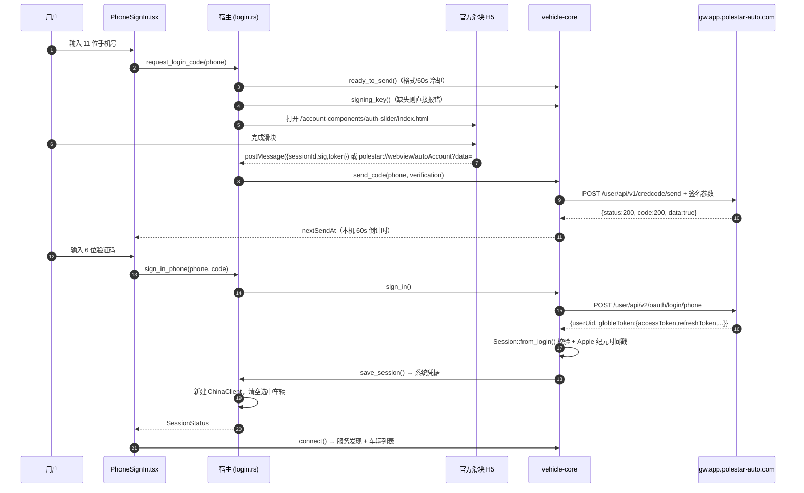
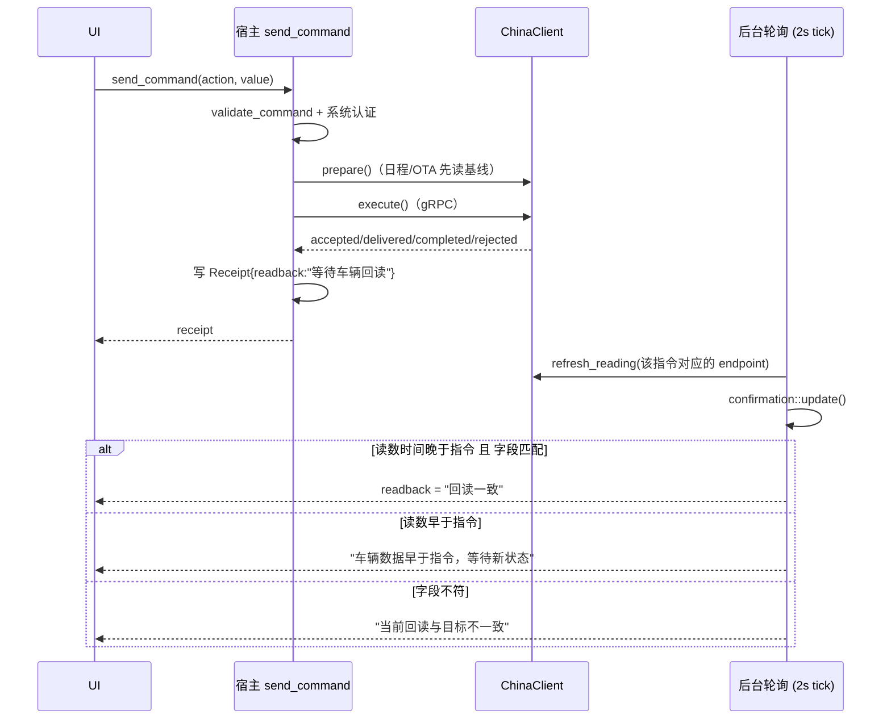

# Norr（北行）代码分析

> 分析对象：`pepsing/Norr`（MIT），已 fork 至 `qicents/Norr` 并克隆到本工作区。
> 分析日期：2026-11-21。本文基于静态阅读 + 素材清单实测；运行时验证结果单独标注。

---

## 0. 结论摘要

**这是什么。** Norr 是一个 Polestar 车主客户端：共用一套 React 界面，macOS / Windows / Android / iOS 用 Tauri 2 承载，HarmonyOS 用 ArkTS + ArkWeb 承载，业务核心是一份 Rust crate（`crates/vehicle-core`），直接访问 Polestar 中国区厂商服务。另配 Apple Watch App、iOS/macOS/Android 桌面小组件、Siri 快捷指令。

**代码质量。** 明显高于常见"逆向客户端"：协议解析手写但带边界检查与单测；能力位（capability）严格"只有显式 `true` 才放行"；指令结果与车辆回读证据分离；凭据按平台落到 Keychain / Keystore / DPAPI / 加密文件；错误文案不泄露服务端原文。设计文档（`DESIGN.md`、`docs/PROGRESS.md`）记录了大量真机验证边界，且明确区分"已验证 / 待验证"。

**关键事实。**

| 项目 | 结论 |
| --- | --- |
| 可用的真实车辆 | 中国区 **Polestar 2**（`remoteControlType` 为 `ICUP` / `AccountLinking`），14 类读取 + 20 余种指令 |
| Polestar 4 | **只有外观素材，没有服务适配**。`HUANFU` 平台在 `ChinaClient::vehicle()` 被直接拒绝 |
| 登录 | 中国大陆手机号短信 / 密码登录 + **官方滑块 H5**；会话存系统凭据并自动续期 |
| 车控 | gRPC（手写 protobuf 编解码）+ REST 服务发现；两级通道 c3 / c3Lbs(chronos) |
| 素材 | 256 个文件（176 张官方图 + 80 张本地抠图），22.46 MB，清单 SHA-256 全部可对上 |
| 最大风险 | **Polestar 图片再分发授权未确认**，而仓库公开且 Release 分发包内含全部车图 |

---

## 1. 仓库结构与技术栈

```
.
├── apps/
│   ├── web/                 React 19 + Vite + TS：演示站 + 原生共用界面
│   ├── native/              Tauri 2 宿主（macOS / Windows / Android / iOS）
│   │   └── src-tauri/       Rust 命令层、macos.m、iOS Swift 插件、Watch、Widgets
│   └── harmonyos/           ArkTS + ArkWeb + NAPI → 同一个 Rust 核心
├── crates/vehicle-core/     厂商协议核心（auth / china / wire / transport / ...）
├── scripts/                 素材抠图、版本与发布
├── docs/                    设计、进展、研究、验收记录
└── .github/workflows/       build.yml（检查+打包）、release.yml（定时/手动发布）
```

代码规模（本工作区实测，排除 `.git`）：

| 语言 | 行数 | 说明 |
| --- | --- | --- |
| TSX | 9,317 | 页面与原生界面 |
| Rust | 7,913 | 车辆核心 + 宿主（含测试） |
| CSS | 3,669 | `styles.css` 2,740 + `native.css` 916 |
| Swift | 3,002 | iOS 插件、Widget、Watch、Siri |
| JS/MJS | 2,264 | 发布、打包、校验脚本 |
| TS | 924 | 类型、客户端封装、车型目录 |
| ArkTS | 589 | 鸿蒙页面与桥接 |
| ObjC | 337 | macOS 原生桥（`macos.m`、`verification.m`） |

**架构分层（数据流）：**



设计上把"协议"和"宿主"切得比较干净：`vehicle-core` 不依赖 Tauri，纯 `reqwest + tonic`，因此鸿蒙能通过 NAPI 复用同一套逻辑。这是这个仓库最值得借鉴的地方。

---

## 2. 登录链路（重点）

### 2.1 端到端流程



### 2.2 网关签名（`china.rs:528`）

所有登录/续期请求都走 `gateway_url()`，参数是固定的九项：

```
appId=polestar-app-android
appVer=4.25.0
brand=apple
clientType=PHONE
deviceId=<UUID 大写，首次生成后持久化>
deviceModel=Mac
nonce=<随机 UUID 大写>
systemVer=macOS
timestamp=<毫秒>
```

排序后拼成 `k=v&k=v...`，再计算：

```rust
sign = md5(format!("{key}{canonical}{key}"))
```

即 **MD5(key + query + key)**，不是 HMAC。`key` 来自 `NORR_POLESTAR_CN_SIGNING_KEY` 环境变量或构建时 `option_env!` 嵌入（`credentials.rs:142`）。单测用固定夹具校验签名（`china.rs:1052`），说明这是照 Swift 原实现逐字节复刻的。

观察：
- 参数里 `deviceModel=Mac` / `systemVer=macOS` / `brand=apple` 与 `appId=polestar-app-android` 自相矛盾——典型的"用 Android 客户端协议、跑在 Mac 上"的逆向痕迹。厂商风控若收紧，这里最先出问题。
- MD5 拼接密钥不是安全构造，但这是厂商协议既定格式，客户端无法改。

### 2.3 滑块验证（三种实现，同一套契约）

官方页面：`https://h5.app.polestar-auto.com/account-components/auth-slider/index.html`。

| 平台 | 实现 | 关键点 |
| --- | --- | --- |
| macOS | `verification.m`：`NSPanel` + `WKWebView`（520×340），sheet 挂在主窗口 | 注入 `window.chromium.postMessage` 桥；`WKWebsiteDataStore.nonPersistent`；300s 超时；`decidePolicyFor` 只放行完整页面 URL |
| iOS | `PhoneVerificationController.swift`：`UIViewController` + `WKWebView`（高 270） | 同样的注入与来源校验；`nonPersistent()` |
| Windows | `verification_windows.rs` + `verification_windows.js`：独立 WebView2 窗口 | 使用官方 `?from=webview` 回调；Tauri ACL 需放行 `https://h5.app.polestar-auto.com` 来源（`docs/PROGRESS.md` 记录了 alpha.5 的 ACL 失败） |
| Android | `NorrPlugin` 的 `verifyPhone`（WebView + JS bridge） | 与 iOS 共用 Rust 侧 `Verification` 结构 |
| HarmonyOS | `PhoneVerification.ets` 独立页面 | 修复过"验证成功但弹框不关"，改用 `from=webview` 消息回调 |

接收端校验（`verification.m`）值得单独说：

- 只接受**主框架**消息，且 `origin.protocol == https`、`origin.host == h5.app.polestar-auto.com`、端口 0/443；
- 消息体 ≤ 16 KB，必须是 `{` 开头的 JSON，或 `polestar://webview/autoAccount?data=<urlencoded JSON>`；
- 三个字段 `sessionId / sig / token` 必须都是非空字符串，否则提示重试而不是关闭窗口；
- `finish()` 幂等，清理 message handler、停止加载、结束 sheet。

这套校验比多数同类项目严谨。剩余风险见 §9。

### 2.4 短信与密码（`auth.rs`）

| 步骤 | 接口 | 请求体要点 | 失败处理 |
| --- | --- | --- | --- |
| 发码 | `POST /user/api/v1/credcode/send` | `principal`、`aliScene=ic_login_h5`、`aliSessionId/aliSign/aliToken`、`clientId`、`type=SIGNIN_BY_PHONE` | 429 → "操作频繁"；非 2xx → 带 HTTP 码；`data != true` → 未确认 |
| 短信登录 | `POST /user/api/v2/oauth/login/phone` | `clientId`、`phone`、`credential`、`autocrt:true` | 统一文案"请检查验证码"，不回显服务端 message |
| 密码登录 | `POST /user/api/v2/oauth/login/password` | 同上 + `password` | 统一文案"检查手机号和密码" |

细节：
- 手机号只接受 `1` 开头 11 位 ASCII 数字；验证码 6 位；密码非空且 ≤ 4096。全角数字会被拒（有测试）。
- 发码有 60 s 冷却，且冷却在**网络请求前**判断；`nextSendAt` 回传前端做倒计时。
- `pending_session`：登录成功后如保存失败，重试会复用已签发会话，避免重复消耗验证码。
- 密码用 `Zeroizing<String>` 包裹，登录结束清空；响应体也用 `Zeroizing<Vec<u8>>` 承接，并限制 128 KB。
- 响应必须是 `{status:200, code:200, data:...}` 双层 200，否则按路径给固定文案。

### 2.5 会话模型与续期（`credentials.rs:66`）

```rust
Session { login: { user_uid, globle_token: Grant, ... }, global_issued_at, issued_at }
Grant   { access_token, refresh_token, token_type, expires_in }
```

- 字段名 `globleToken` 是厂商的拼写错误，代码原样保留（`#[serde(rename_all = "camelCase")]`）。
- 时间戳用 **Apple 纪元**（2001-01-01，偏移 978307200 秒），与原 Swift 实现一致；`expires_at = (global_issued_at + APPLE_EPOCH + expires_in) * 1000`。
- `needs_refresh()` 提前 **60 秒**续期。
- 续期：`POST /user/api/v2/oauth/refresh-global-token`，`psoneid: userUid` 头 + `{refreshToken}` 体；成功后 `replace_grant()` 并立即落盘。
- 401 兜底：`connect()` 遇 `HTTP 401` 强制续期重试一次；`refresh()` 里若某几项返回 `AUTH_ERROR`（gRPC Unauthenticated），强制续期后**只重读失败项**（`china.rs:316`）。
- 会话 `validate()` 检查：uid/access/refresh 非空、`tokenType` 为 bearer、`expires_in ∈ [1, 31536000]`。

### 2.6 各平台凭据存储

| 平台 | 后端 | 位置/机制 | 备注 |
| --- | --- | --- | --- |
| macOS | Keychain | `security-framework`，service `app.norr.mac`，先试 protected keychain，失败回退普通 | 兼容旧 Hisingen service（仅 debug） |
| iOS | Keychain | service `app.norr.ios` | 与小组件/手表通过 App Group 共享的是快照，不是 refresh token |
| Windows | DPAPI 文件 | `%LOCALAPPDATA%/app.norr.windows/credentials/<account>.dpapi` | `CryptProtectData` 绑定当前 Windows 账户 |
| Android | Keystore（经插件） | `readCredential` / `writeCredential` 走 `norr-mobile` 插件 | Rust 侧通过 `SecureStorage` trait 注入，便于测试 |
| HarmonyOS | Asset Store 派生密钥 + AES-256-GCM 文件 | `NRH1` 魔数 + 12B nonce + 密文，AAD=账号名 | key 由 `norr_storage_key`（Asset Store）包裹；目录 0700 |

凭据不落 JSON、不写日志；`import_hisingen` 只在 macOS debug 下存在，符合"开发测试"定位。

---

## 3. 车控链路（重点）

### 3.1 服务发现与双通道（`china.rs:118`）

1. `GET https://cnepmob.volvocars.com.cn`，`Authorization: Bearer <accessToken>`，`Accept: application/volvo.cloud.cnepmob.v1+json`；
2. 返回里取 `c3.url`（REST 基址）、`c3.grpcHost/grpcPort`、`c3Lbs`；
3. `trusted_url()` 强制 **https + 域名白名单**（`volvocars.com.cn` / `volvocars.com` / `polestar.cn` / `polestar.com` / `polestar-auto.com`，含子域），且禁止 userinfo / query / fragment（`china.rs:490`）；
4. 车队：`{c3.url}/car-information/car`，逐项 `parse_car()`：VIN 必须 17 位字母数字；`remoteControlType` 作为平台；`supports*` 收进 `capabilities`；`*Limit` 与 `parkingClimatizationMaxNumberOfTimers` 收进 `limits`；
5. 元数据缓存 **10 分钟**，过期重连（`ensure_metadata`）。

两条 gRPC 通道：

| 通道 | 用途 | TLS |
| --- | --- | --- |
| `c3` | 车身状态、Invocation 指令、OTA | 桌面用系统根证书，移动端用 webpki 内置根 |
| `c3Lbs`（chronos） | 充电目标/电流、空调与充电日程、充电地点、车辆位置 | 同上；连接失败可为 `None` |

`transport.rs` 用 `tonic` 的**裸字节 Codec**（`RawCodec`），不做 protobuf 代码生成；请求带 `authorization: Bearer`、`vin` 元数据、25 s 超时、`user_agent("grpc-java-okhttp/1.68.2")`。响应是 server-streaming，按 `first_only` 取首条或最后一条。

> 手写 protobuf（`wire.rs`）是一大亮点：`Message::parse` 支持 varint / fixed32 / fixed64 / length-delimited，限制 2 MB、防溢出、字段号 0 拒绝；`payload()` 还校验外层字段 2 的 VIN 与请求一致，防止串车。

### 3.2 读取项目（14 类）

`refresh()` 用 `tokio::join!` 并发拉取，单点失败不影响整体：

| key | gRPC 路径 | 解析要点 |
| --- | --- | --- |
| `battery` | `/services.vehiclestates.battery.BatteryService/GetLatestBattery` | 百分比限 0–100；`powerKw = number(10)/1000`；`minutesToFull/Target`、`connection`、`chargeState(V2)` |
| `exterior` | `...exterior.ExteriorService/GetLatestExterior` | **数字新格式**：`int(2)` 为锁（2=锁/1=开），`int(3..14)` 为 12 个开合件；**旧格式**回退到 `nested(1).int(1)`，且没有 openings |
| `climate` | `...parkingclimatization.../GetLatestParkingClimatization` | 新格式看 `bytes(1)` 是否存在；`running` 映射为 `active/starting/idle/unknown`；新格式才给车内/目标温度 |
| `odometer` | `...odometer.OdometerService/GetOdometer` | 米 → 公里；trip、平均速度、自上次充电里程 |
| `target` | `/chronos.services.v1.TargetSocService/GetTargetSoc` | 1–100 |
| `amperage` | `/chronos.services.v1.AmpLimitService/GetAmpLimit` | 1–64 A |
| `health` | `...health.HealthService/GetHealth` | 胎压 39–42、告警 9–12、参考胎压 43/44、告警位 5–8/13/38、保养天数/里程（`u32::MAX` 视为缺失） |
| `airQuality` | `...precleaning.PreCleaningService/GetPreCleaning` | AQI/PM2.5/PM10/滤芯百分比/剩余分钟 |
| `location` | `/dtlinternet.DtlInternetService/GetLastKnownLocation` | 三种字段布局（compact / shifted / wrapped），**多于一个候选即报"未返回明确位置"**，拒绝猜测 |
| `software` | `/ota_mobcache.OtaDiscoveryService/GetSoftwareInfo` | 请求体带 `zh-CN`；版本、状态、下载时长、计划时间 |
| `softwareSchedule` | `/ota_mobcache.SchedulerService/GetSchedule` | status / scheduledAt / softwareId |
| `climateTimers` | `/chronos.services.v1.ParkingClimateTimerService/GetTimers` | 合并字段 3/4，剔除字段 5 中已删除的 id |
| `chargeTimer` | `/chronos.services.v2.GlobalChargeTimerService/GetGlobalChargeTimerStream` | 开始/结束分钟、启用 |
| `chargeLocations` | `/chronos.services.v1.ChargeLocationService/GetChargeLocations` | 地点名、电流、最低电量、充电/出发两组定时 |

"缺失 vs 显式 0"被刻意区分：`Message::int()` 返回 `Option`，单测 `preserves_missing_and_explicit_zero` 专门守这个语义。电池百分比缺失会是 `null` 而不是 0。

### 3.3 指令映射（`china.rs:680`）

| action | gRPC method | 通道 | 能力位 | 字段 2 |
| --- | --- | --- | --- | --- |
| `lock` / `unlock` | `InvocationService/Lock` / `Unlock` | c3 | `supportsLock` / `supportsUnlock` | 0 |
| `flash` | `InvocationService/HonkFlash` | c3 | `supportsFlash` | 2 |
| `honkFlash` | 同上 | c3 | `supportsHonkAndFlash` | 0 |
| `unlockTrunk` | `Unlock` | c3 | `supportsRemoteTrunkUnlock` | 1 |
| `tailgateOpen/Close` | `TailgateControl` | c3 | `supportsRemoteTrunkControl` | 1 / 2 |
| `windowsOpen/Close` | `WindowControl` | c3 | `supportsRemoteWindowControl` | 1 / 2 |
| `cleanStart/Stop` | `PreCleaning` | c3 | `supportsAirPurification` | 1 / 0 |
| `climateStart` | `ClimatizationStart` | c3 | `supportsParkingClimatization` | 1 + `float(3, 温度)` |
| `climateStop` | `ClimatizationStop` | c3 | 同上 | 0 |
| `target` | `TargetSocService/SetTargetSoc` | chronos | `supportsTargetChargeLevelSetting` | `int(2)=值`, `int(3)=3` |
| `amperage` | `AmpLimitService/SetAmpLimit` | chronos | `supportsGlobalChargeAmperageLimitSetting` | `int(2)=值` |
| `chargeStart/Stop` | `ChargeNowService/StartOverrideChargeTimer` | chronos | `supportsChargeNowTimerOverride` | 仅 chronos 请求体 |
| `chargeTimer` | `GlobalChargeTimerService/SetGlobalChargeTimer` | chronos | `supportsGlobalChargeTimer` | 嵌套日程 + `int(3,0)` |
| `climateTimer` | `ParkingClimateTimerService/SetTimers` | chronos | 三个 timer 能力位任一 | 嵌套日程 |
| `deleteClimateTimer` | `.../DeleteTimer` | chronos | 同上 | `string(2, id)` |
| `otaSchedule/Install/Cancel` | `SchedulerService/{Schedule,InstallNow,CancelSchedule}` | c3 | `supportsRemoteOtaInstallSchedule` | 时间分钟 / 软件 id |

**能力门禁**是硬性的（`command_request` + 前端 `unavailableReason` 双重）：

- 只有 `Some(true)` 放行；`Some(false)` 明确"不支持"；`None` 是"服务尚未提供能力信息"——三种状态文案不同；
- 充电类额外要求 `supportsChargingFunctions === true`；
- 空调设温额外要求 `supportsParkingClimatizationCompartmentTemperatureSettings`；
- 平台必须是 `ICUP` / `AccountLinking`，否则"该平台适配待完成"（P4 的 `HUANFU` 就卡在这）；
- 共享账号（`userIsOwner=false`）**不阻止**控制，只要车辆返回了能力位——这与 `AGENTS.md` 的"保留共享账号合法控制路径"一致，单测 `shared_account_climate_validation...` 明确覆盖。

### 3.4 本地参数校验

- 温度：默认 22 ℃，范围取车辆 `*MinLimit/MaxLimit` 并夹到 [16, 30]，步进 0.5；
- 目标电量：下限取 `targetChargeLevelPercentageMinLimit`（默认 40），上限 100，整数；
- 电流：`chargeAmperageMinLimit/MaxLimit`（默认 6–32），整数；
- 日程：开始/结束 < 1440 分钟，星期 1–7 去重，充电窗口必须"起止不同且每天生效"，空调日程只设开始时间，且重复方式要与对应能力位匹配；
- OTA：2–10080 分钟，安装前车辆 `state ∈ {3,10,12}`，取消前 `schedule.status == 2`；
- 时区偏移：`-840..=840`。

### 3.5 发送与回执语义（`china.rs:448` / `878`）

不同服务的状态码含义**不一样**，代码分别处理：

| 通道 | accepted | delivered | completed | rejected |
| --- | --- | --- | --- | --- |
| Invocation（c3） | 1 | 4 | 6 | 9 / 10 / 12 |
| chronos | 1 | 2 | 3 / 4 / 8 | 5–7 |
| 充电 override | 字段 1/2 = 1 | — | — | 2–4 |
| OTA | 嵌套 `int(1)` = 1/2 | 3 | — | — |

`lock` 还有一个特例：外层 `bytes(1)` 存在且 `int(2) != 0` 时，直接判"车辆拒绝锁车，请检查车门、前盖和尾门"。

`status_text()` 把状态翻译成四级中文：服务已接受 / 已送达车辆 / 服务报告已完成 / 车辆拒绝执行，未知则"执行结果待核对"。**注意：`completed` 仍不等于"已生效"**，真正生效要等回读。

### 3.6 回读确认（`confirmation.rs`）

这是全项目最值得读的部分。指令回执（服务端）与车辆状态（车端）被明确分成两条证据链：



规则细节：

- **端点映射**：锁/尾门/车窗 → `exterior`；空调 → `climate`；目标/电流 → 对应读取；日程 → `climateTimers`/`chargeTimer`；净化 → `airQuality`；充电开始 → `battery`。
- **时间窗**：快照距指令超过 10 分钟不再判定；读数 `observed_at` 必须晚于指令 `time`。
- **新鲜度**：除"直接设置"类（target/amperage/timers）外，还要求 `reported_at >= 指令时间`，否则"车辆数据早于指令"。这防的是"读到缓存旧值就宣布成功"。
- **字段匹配**：锁 `locked==true`；解锁 `false`；空调 `activity=="active"` 且（若指定温度）`targetTemperature` 相等；车窗四个都到位；尾门 1/2；净化 state；充电 `chargeState==1`。
- **删除日程**：必须基线里存在该 id、且回读列表里没有它才算成功——空列表/畸形列表不能"证明删除"。
- **新建日程**：必须出现一个**基线中不存在的新 id**，且所有字段一致，防止把旧日程误判为新建成功。
- 轮询侧 `pending_readback()`（`lib.rs:152`）：同一 (VIN, endpoint) 只保留最新一条；120 s 内未确认才继续；已 `rejected` 不参与；`account_scope`（`sha256(userUid)`）隔离不同账号的历史。
- iOS 的 Siri 入口另有一道 `siri::unresolved_command()`：同车同组动作存在未核对指令时，拒绝再发（相同指令则返回原 receipt）。

### 3.7 后台采集与通知

`collect_in_background`（`lib.rs:563`）是一个 2 s tick 的循环，`tokio::select!` 同时等"指令唤醒"和定时：

- 系统休眠时跳过；
- 有待核对指令 → `read_command_state()`：只刷新对应那一个 endpoint，并把读数合并回最近快照，避免整包 14 项；
- 否则按设置间隔（0/60/120/300/600 s）整包刷新；
- 唤醒后（`refresh_on_wake`）先以 2 s 间隔快速刷一次；
- 每次 `record()` 会：应用回读 → 观察充电/指令通知 → 追加快照（上限 5000）→ 写 JSON → 同步 SQLite；
- 桌面端更新托盘标题（`Norr 42%`），移动端同步 Watch/Widget 快照。

### 3.8 风险与可改进点

1. **无幂等键**：`send_command` 没有 request-id 去重。网络超时后用户重试，可能对同一动作发两次（锁车问题不大，OTA 安装/日程写入有影响）。Siri 的 guard 只覆盖 iOS 语音入口。
2. **"最后一条 stream 消息"语义**：`transport::request` 在 `first_only=false` 时取最后一条，若服务端持续推送心跳，可能读到非终态。目前靠回执状态机兜底。
3. **能力位依赖厂商返回值**：`parse_car` 只收 `supports*` 布尔；若厂商改成字符串 `"true"`，会静默变成 `None` → 全部按钮禁用。保守但脆弱。
4. **前端与后端重复实现能力判断**（`client.ts:unavailableReason` vs `china.rs:command_request`），规则漂移风险；建议由后端返回"可否执行 + 原因"。
5. **平台白名单硬编码**（`ICUP`/`AccountLinking`）。接 P4 需要新增协议族，不是加个字符串就行。

---

## 4. 车辆展示素材（重点）

### 4.1 实测清单

对 `apps/web/public/images/vehicles/manifest.json` 逐项核对（脚本比对文件存在性与 SHA）：

| 指标 | 实测值 |
| --- | --- |
| 清单条目 | **256** |
| 官方 studio 图 | 160（80 组合 × 侧面/前侧） |
| 本地派生抠图 | 80（`derived-cutout`，无损 WebP） |
| 官方透明图 | 16（P2 6 + P4 10，`cutout`） |
| 磁盘文件数 | 256，**缺失 0** |
| SHA-256 去重 | 256 个互不相同 |
| 总字节 | 22,458,790（约 21.4 MiB） |
| P2 / P4 | 96 / 160 |

组合数：P2 = 6 色 × 5 动力/外观 × 1 饰板 = 30 → 60 张；P4 = 5 色 × 5 配置 × 2 饰板（black/body）= 50 → 100 张。

### 4.2 目录与命名

```
images/vehicles/
├── manifest.json
├── polestar-2/{standard-single,long-single,long-dual,long-dual-pro,long-dual-performance}/
│   ├── snow-black-side.jpg
│   ├── snow-black-front.jpg
│   ├── snow-black-side-cutout.webp
│   └── ...
└── polestar-4/{rear,dual,rear-sport,dual-sport,dual-performance}/
    ├── snow-black-side.jpg / snow-body-front.jpg / ...
    └── ...-cutout.webp
```

规则由 `vehicle-catalog.ts` 的 `artworkPath()` / `sideCutoutPath()` 统一生成：

```
{BASE_URL}images/vehicles/{modelId}/{variantId}/{colorId}-{cladding}-{view}.jpg
side 图 → 同名 -cutout.webp
```

车型目录（`vehicle-catalog.ts`）是**单一数据源**：

- P2：Snow / Vapour / Dune / Midnight / Storm / Space；5 个动力版本；19″ Aero、20″ Pro graphite、20″ Performance；
- P4：Snow / Magnesium / Electron / Storm / Space；Rear / Dual / Rear Sport / Dual Sport / Dual Performance；20/21/22″；黑/车身同色饰板。

`validAppearance()` 对备份恢复做白名单校验，非法外观回退默认值——避免损坏的备份把路径拼成任意文件。

### 4.3 深浅两套图的设计

- **浅色**：直接用 1440×810 官方棚拍 JPG（浅灰背景），保留原始车漆与轮毂；
- **深色**：换成同构图透明 WebP，铺在炭灰舞台 `#20231F` 上；
- 两者同尺寸、同取景，切换主题时车身不跳动（`DESIGN.md` 明确要求）。

`VehicleArtwork` 的处理：`darkStage && view==="side"` 才用抠图；`onError` 落到占位（车型 + 颜色 + 重试按钮）；`width/height` 固定，避免 CLS；`fetchPriority` 用于首屏。

### 4.4 抠图管线（`scripts/prepare-vehicle-cutouts.py`）

不是简单调 `rembg`，而是一套"以 Space 漆为参考的合成":

1. 取同配置 `space-{cladding}-side.jpg` 作为剪影参考；
2. `rembg` U2Net 粗分割 → 膨胀 6 次 → 与"背景色差 > 6"求交 → 取最大连通域 → 填洞；
3. 距离变换把内部像素映射到最近的内部源色，估计前景色，反解 alpha（`(bg-px)/(bg-fg)`），内部强制 alpha=1；
4. 下半部（车底 25%）用源图自身的 mask 重新求 alpha，解决车漆反光导致的门槛边界问题；
5. 重建地面阴影：亮度比 → 阴影 alpha，与车体 alpha 合成；
6. 输出**无损** WebP（`lossless=True, method=6`），并把 `derivedFrom`、`segmentationReference`、字节数、SHA 写回 manifest。

这套方法的好处是：白色车漆、轮毂细辐条、下饰板边缘都能保住，且不引入合成色（README 明确"no synthesized paint colours"）。

### 4.5 素材侧风险（重要）

1. **版权**：`README.md` 自己写着 "Polestar retains rights to its imagery. Publication and redistribution permission remain unverified."。仓库是公开的，Release 的 macOS/Windows/Android/iOS/HAP 包里都带着这些图，等于**公开再分发**。这是项目最大的法律风险，不是技术风险。若要长期公开，建议：从仓库与发布包移除官方图、改为用户本地导入，或取得书面授权。
2. **包体**：22 MB 素材进安装包（HAP 33.7 MB），移动端可接受但可优化（按车型/配置懒加载、AVIF）。
3. **时效**：素材锁定 MY2027 / 英国官网；官网 URL 或渲染器参数变化后无法复现。
4. **P4 的"展示 vs 实车"落差**：界面能选 P4 并展示 100 张官图，但真实 P4 车辆在 `vehicle()` 就被拒。用户容易误以为"支持 P4"。建议在 P4 卡片上直接标注"仅外观素材，服务未接入"。

---

## 5. 前端：一个仓库两套入口

`main.tsx`：

```tsx
isTauri() || isHarmonyOS ? <NativeApp /> : <App />
```

| 入口 | 定位 | 状态来源 |
| --- | --- | --- |
| `App.tsx`（浏览器） | 交互演示 / 设计稿 | `workspace.tsx` 全内存 + `localStorage`（`hisingen-design-workspace-v2`） |
| `NativeApp.tsx`（原生/鸿蒙） | 真实车辆 | Tauri IPC / ArkWeb 桥 → Rust |

**演示层**（`workspace.tsx`，888 行）设计得相当完整：车库、日程、充电地点、回执、油耗、隐藏行程、订阅例程、备份恢复、旧数据迁移。演示登录固定验证码 `123456`，页面上明确标注"演示"。

**原生层**（`NativeApp.tsx`，1540 行）是真正复杂的地方：

- 页面：`vehicle / controls / charging / history / settings`；
- 指令弹窗 `dialog: Command`，按 action 决定是否需要数值、范围、步进（`commandLimits`）与预设（`chargingOptions`）；
- `control()` 渲染每个按钮时先算 `unavailableReason`，禁用并显示原因；
- 发送后：`receipt` → 若无回读项且未拒绝，立即刷新；
- 事件：`vehicle-updated` / `refresh-failed` / `desktop-failed` / 小组件与通知的深链。

**共用 UI**：`EnergyPanel`、`Modal`、`VehicleArtwork`、`VehicleAppearancePicker`、`WorkspaceUI`（SectionTabs/EmptyState/DataRow）、`HistoryTrend`。设计 token 全在 `styles.css`，原生特有布局在 `native.css`。字体 Archivo（`@fontsource`，OFL）。

**测试**：`apps/web/tests/*.test.mjs` 共 21 项（map-links 5、native-client 10、vehicle-details 3、widgets 3），用 `vite` 的 `createServer` 直接加载 TS 源码，覆盖能力判断、坐标转换、小组件快照整理。Rust 侧 48 个 `#[test]/#[tokio::test]`。

---

## 6. 各平台宿主

| 平台 | 关键实现 | 系统能力 |
| --- | --- | --- |
| macOS | `desktop.rs` + `macos.m` | 菜单栏托盘、`SMAppService` 登录启动、`UNUserNotificationCenter` 通知、`NSWorkspace` 睡眠/唤醒、`LAContext` 本机认证、Apple/高德地图、WidgetKit |
| Windows | `desktop_windows.rs` + WebView2 | 托盘、启动项、Toast、Windows Hello、DPAPI、NSIS 安装包 |
| Android | `NorrPlugin`（Kotlin）+ `mobile.rs` | Keystore、WebView 登录、AppWidget（3 尺寸、响应式）、前台通知、文件选择 |
| iOS | `NorrPlugin.swift`、`PhoneVerificationController.swift`、`Widgets.swift`、`WatchBridge.swift` | Keychain、WKWebView 登录、WidgetKit（S/M/L、深浅）、App Intents/Siri、WatchConnectivity |
| HarmonyOS | ArkTS + ArkWeb + `libentry.so`（NAPI） | 本地资源拦截 `https://norr.localhost/`、Asset Store、加密文件、文件选择、`userAuth` 生物认证 |

差异点：Android/iOS/HarmonyOS 的采集只在前台跑；macOS/Windows 关窗后仍驻留。这解释了为什么移动端"刷新间隔"意义有限。

---

## 7. 数据、历史与隐私

- `history.json`：快照 5000 条、回执 2000 条上限，原子写（临时文件 + fsync + rename），文件权限私有；
- `history.sqlite3`（`archive.rs`）：把 JSON 里的快照/回执镜像成行，支持按 VIN + 时间范围查报表；兼容 Hisingen 旧库（13 张表）；
- `insights.rs`：充电分段（>10 分钟断开视为中断）、行程切分、电量/里程曲线、CSV 导出；
- 备份：`Archive::backup` 导出 JSON，导入先 `preview` 再 `commit`（token 防重放），`Record` 用 `deny_unknown_fields`；
- 隐私：截图模式、按车清除历史、交接导出、账号/车辆移除；
- 账号隔离：`account_scope = sha256(userUid)`，换账号后旧回执不会误判。

---

## 8. 构建与发布

- npm workspaces（`apps/web`、`apps/native`），根 `package-lock.json` 锁定；Node ≥ 22.12；
- `npm run dev`（Vite 5173）/ `build` / `typecheck` / `check:native`（`cargo test --workspace`）；
- 原生：`build:mac|windows|android|ios|ios:unsigned|harmonyos`，脚本在 `apps/native/scripts/`（含 iOS 嵌套签名、Widget 校验、Windows 验证页测试）；
- CI：`build.yml`（push/PR + 可复用 workflow）跑发布脚本测试、前端测试、构建、多平台矩阵；`release.yml` 每日 19:20 UTC（北京 03:20）检查未发布提交，自动 alpha；手动可指定正式版本号；`[skip ci]` / `[skip release]` 约定；
- 发布脚本 `scripts/release/release.mjs`（17 KB）+ 版本注入 `version.mjs`，有完整单测；上传后核对远端 SHA-256。

---

## 9. 安全与合规评估

| # | 事项 | 现状 | 风险 | 建议 |
| --- | --- | --- | --- | --- |
| 1 | 中国区签名 key | 构建期 `option_env!` 嵌入二进制，或从 Keychain 读 | 中：key 随包分发，可被提取 | 明确告知用户；不要把 key 提交仓库；考虑运行时下发/用户自备 |
| 2 | 网关签名 | `md5(key+query+key)` | 低（协议既定）：非 HMAC，长度扩展/碰撞面存在 | 无法单方面改；不要在此基础上加自研安全假设 |
| 3 | 客户端伪装 | `appId=polestar-app-android` + `deviceModel=Mac` + UA `grpc-java-okhttp` | 中：违反厂商 ToS 的可能性，风控升级即失效 | 文档明示"非官方客户端"；准备协议变更应急 |
| 4 | TLS | 系统根 / webpki 根 | 低-中：无证书固定，易被中间人（尤其配合自定义根） | 可加 pinning（但会增加维护成本） |
| 5 | 滑块页桥接 | 向官方 H5 注入 `window.chromium.postMessage` | 中：注入脚本与页面同源，页面被篡改则桥被滥用；回调解析接受两种格式 | 已限制主框架/HTTPS/host；可再加 CSP 与字段长度上限（已有 8192） |
| 6 | 系统认证 | 解锁、开尾门、开车窗、鸣笛、OTA、删日程需生物/系统认证 | 好 | 建议 `lock` 之外的所有"改变物理状态"动作都纳入 |
| 7 | 密码处理 | `Zeroizing`，不落盘，仅内存 | 好 | 保持；注意 IPC 明文（本地回环，可接受） |
| 8 | 错误信息 | 服务端 message 不回显 | 好 | 保持 |
| 9 | 备份导入 | `deny_unknown_fields`、preview/commit、token | 好 | 建议加文件大小上限（目前主要靠读取端） |
| 10 | 地图 URL | 严格 host/path 白名单 | 好 | 保持 |
| 11 | 车图版权 | 公开仓库 + 发布包含官方图，授权未确认 | **高（法律）** | 移除/替换/取得授权；至少在 README 与 Release 显著声明 |
| 12 | 素材来源 | manifest 记录 URL、SHA、尺寸 | 好 | 保持可追溯 |

---

## 10. 如果你要继续做（建议路线）

**想接 Polestar 4：**
1. 先抓 P4 的 `remoteControlType`（大概率 `HUANFU`）与服务发现返回，确认是否 Geely 体系；
2. 在 `vehicle-core` 新增 `huanfu.rs`（或 protocol trait），不要往 `china.rs` 里塞分支；
3. 能力位、读取项、指令映射按 P4 实际返回重建；`confirmation.rs` 的字段匹配要重写，不能复用 P2 的语义；
4. 前端 `platform` 白名单与 `unavailableReason` 同步放开，并保留"未验证"文案。

通用 C3 协议（VIN-only 请求体、`GetLatest*`、`PolestarApp` chronos）与只读兼容性探测已作为 `Protocol::Generic` 移植，见 [C3Companion 逆向记录与 P4 接口移植](2026-11-21-c3companion-p4.md)。

**想复用这套代码做别的品牌：**
- `wire.rs` + `transport.rs` 是通用的"手写 protobuf over gRPC"工具，可直接复用；
- `confirmation.rs` 的"回执 ≠ 生效，必须独立回读"模型值得照搬；
- 登录的"官方 H5 + 原生桥 + 严格来源校验"是通用模式。

**想改动前先注意：**
- 任何 UI/文案改动先读 `DESIGN.md`（ENERGY 2 / RHYTHM 2 / MOTION 1）与 `AGENTS.md`；
- 改素材必须同步 `manifest.json` 与来源记录；
- 车控改动要同时跑 `cargo test` 与前端 21 项测试；
- 真机/实车验证状态要如实写进 PR（仓库文化如此）。

---

## 11. 本次实际执行的验证

| 检查 | 结果 |
| --- | --- |
| `gh repo fork pepsing/Norr` → `qicents/Norr`，克隆到本工作区 | 成功 |
| 素材清单 vs 磁盘文件（存在性 + SHA-256 去重） | 256/256 存在，256 个唯一摘要，22,458,790 字节 |
| `npm ci`（使用工作区本地 npm cache） | 成功（33 个顶层包） |
| `node --test tests/*.test.mjs`（在 `apps/web` 下） | **21 passed / 0 failed** |
| `npm run typecheck` | 通过（无输出即无错误） |
| `npm run build` | 通过，`✓ built in 910ms` |
| `cargo test -p norr-vehicle-core` | **未执行**：当前环境没有 `cargo`。仓库内共 48 个 Rust 测试，需自备 Rust 工具链 |

> 注：测试必须在 `apps/web` 目录下运行。直接在仓库根执行 `node --test apps/web/tests/*.test.mjs` 会因 Vite 以根目录为 root、解析 `/src/...` 失败而全部报错——这不是代码缺陷，`package.json` 的 `npm test --workspace @norr/web` 会切到正确 cwd。

---

## 附录：关键文件索引

| 主题 | 文件 |
| --- | --- |
| 登录协议 | `crates/vehicle-core/src/auth.rs` |
| 网关签名 / 服务发现 / 指令 | `crates/vehicle-core/src/china.rs` |
| 手写 protobuf | `crates/vehicle-core/src/wire.rs` |
| gRPC 传输 | `crates/vehicle-core/src/transport.rs` |
| 会话与凭据 | `crates/vehicle-core/src/credentials.rs` + `credentials/*` |
| 回读确认 | `crates/vehicle-core/src/confirmation.rs` |
| 日程编解码 | `crates/vehicle-core/src/schedules.rs` |
| 扩展读取 | `crates/vehicle-core/src/telemetry.rs` |
| Tauri 命令层 | `apps/native/src-tauri/src/lib.rs` |
| 登录命令 | `apps/native/src-tauri/src/login.rs` |
| macOS 滑块 | `apps/native/src-tauri/src/verification.m` |
| iOS 滑块 | `apps/native/src-tauri/ios/Sources/NorrMobile/PhoneVerificationController.swift` |
| 原生前端 | `apps/web/src/native/NativeApp.tsx`、`client.ts`、`NativeControls.tsx` |
| 演示状态 | `apps/web/src/workspace.tsx` |
| 车型目录 | `apps/web/src/vehicle-catalog.ts` |
| 车图组件 | `apps/web/src/components/VehicleArtwork.tsx` |
| 素材清单 | `apps/web/public/images/vehicles/manifest.json`、`README.md` |
| 抠图脚本 | `scripts/prepare-vehicle-cutouts.py` |
| 设计规范 | `DESIGN.md`、`apps/web/src/styles.css` |
| 验证记录 | `docs/PROGRESS.md`、`apps/native/README.md`、`apps/harmonyos/README.md` |
