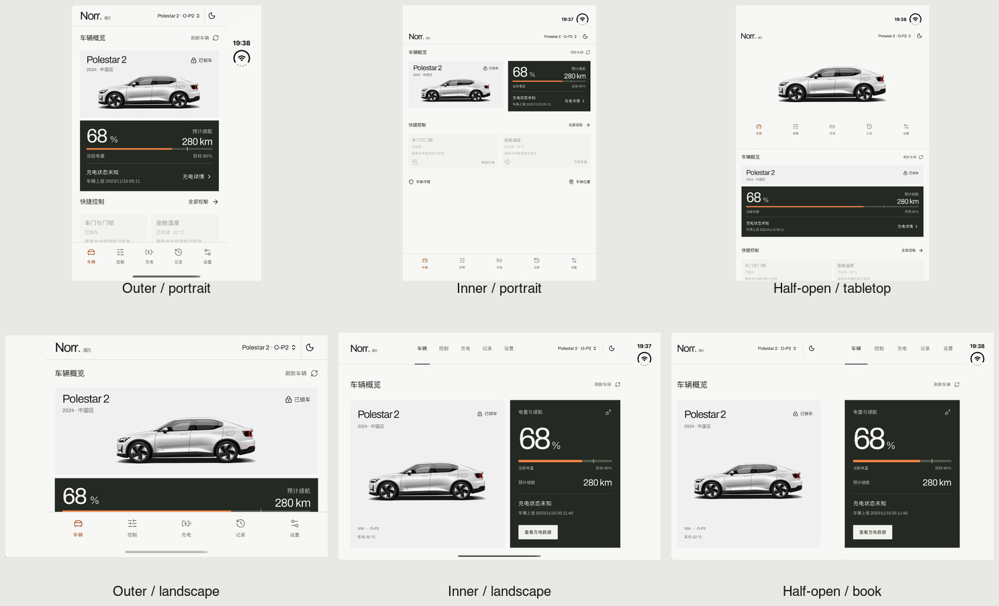
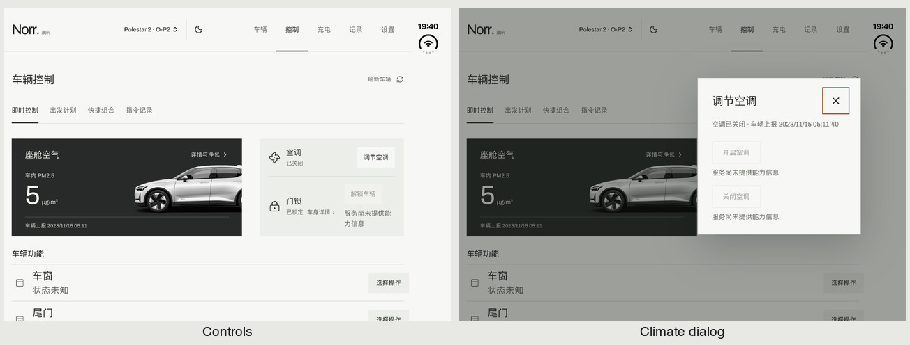
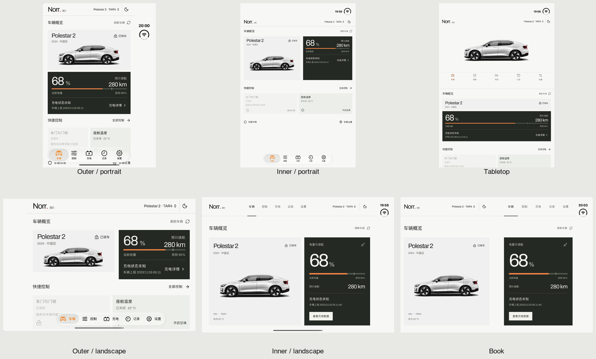
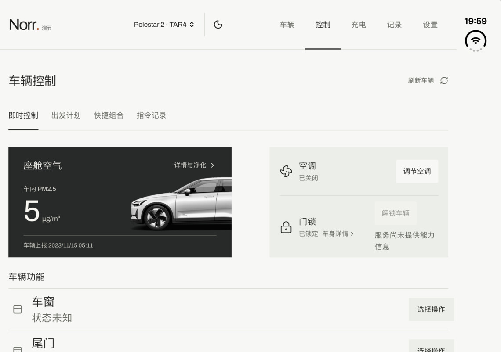

# iPhone Duo 适配审查 · 2026-11-24

审查对象为本地首轮 Duo 实现（`0c1a1b7`）。在 iOS 27.1（24A94425）Duo 模拟器内，用北行的 WKWebView 折线桥接、实际首页与固定 Polestar 2 数据切换六种姿态。下表尺寸为逻辑点，取自对应截图的窗口。TestFlight 反馈来自 iOS 27.2.1 真机，三个反馈版本均早于本地实现。

| 姿态 | 首屏实测 |
| --- | --- |
| 外屏竖向 466 × 678 | 单列。避开系统侧边区域后，车图、电量、续航和底栏均可见。 |
| 外屏横向 678 × 466 | **ToDo，优先**。左右安全区和内边距扣除后，卡片宽 554 pt，低于 580 pt 双列门槛。电量卡从 y=300 延伸到 474，固定导航从 y=371 开始。电量和续航数字可见，卡片下部需滚动。验收条件为同屏显示车图、能源摘要与充电详情入口。 |
| 内屏展开竖向 669 × 951 | 两张主卡可以并排。车图卡仅 161 pt 高，快捷控制下方到导航的留白明显。**ToDo**：优先增大车图，保留首屏快捷控制。 |
| 内屏展开横向 951 × 669 | 两张主卡在首屏完整显示，系统侧边区域与主导航分开。 |
| 书本半折 951 × 669 | 首页车图卡右缘约 440 pt，能源卡左缘约 512 pt，两者避开 x≈456–496 的系统折线区域。控制页的「座舱空气」卡延伸过折线，「详情与净化」靠近折线；空调弹窗完整落在右侧。**ToDo，优先**：控制页按实际折线分栏，让入口可在一侧读完和点按。 |
| 桌面半折 669 × 951 | 车图及五个导航入口在上半屏，导航底缘约 455 pt。下半屏从车况开始，首屏能读到电量、续航和充电入口。 |

## TestFlight 反馈与核查

| 构建 | 测试员反馈 | 核查与 ToDo |
| --- | --- | --- |
| 1025 | 下拉有卡顿感，建议导航采用新版 SDK 的 Liquid Glass。附件展示了 Polestar 的界面作参考。 | 书本式半折做了三次有效下拉，每次观察约 2.4 秒，覆盖刷新成功和收起。WKWebView 帧回调间隔的中位数与 P95 均约 17 ms，各次最长分别为 113、46、37 ms。这是端到端窗口采样，尚无法定位长帧发生在哪个动画阶段。**ToDo**：真机分段采样拖动、松手、回弹。1026 归档已使用 iPhoneOS 27.2 SDK，主导航仍由 WebView 绘制。将原生导航作为独立设计选项评估。 |
| 1024 | 手机与 Watch 可下发指令，回读未成功；多次尝试后出现 HTTP 400 / 业务码 6666 及手机手表断联。快捷指令查询续航时找不到车辆变量。 | **ToDo**：同步核对手机、手表的请求时间、回执与回读；现有证据不足以确定 6666 与断联的因果。当前电量查询 Intent 已声明可选车辆参数，仍需在系统快捷指令编辑器验证新建和既有捷径。 |
| 1021 | 空调长期停在等待回读，建议显示进度、一分钟后解限或重新查询；希望使用新版 SDK 并增加下拉刷新。 | **ToDo**：验证弱网和回读超时的可见状态，以及仅重查车况的恢复路径。1025 已有下拉刷新，1026 的 SDK 版本见上。 |

[原始截屏反馈（需要 App Store Connect 权限）](https://appstoreconnect.apple.com/teams/57610506-1097-4e33-ad27-ca8b70ac357a/apps/6836276990/testflight/screenshots)

本轮使用固定样本，未接入真实车辆、手表或测试员账号。真机刷新帧时序、指令回读、多车快捷指令、P4 六姿态仍待验证。当前可见的崩溃反馈列表中，两条记录的设备均为 iPhone 15 Pro。

## 首轮设计验收（修复前）

- Hard Gate **PASS**。页面标记演示，截图中系统状态区与主导航分开，书本姿态的空调弹窗可在单侧关闭。
- Purpose Gate **FAIL**。外屏横向首屏无法完整呈现能源卡，控制页的详情入口挨着折线。
- Liveliness **PASS**。六种姿态保留车型实图，桌面半折把上半屏用于车辆展示。
- Craftsmanship **FAIL**。外屏横向断点、内屏竖向比例、控制页折线排布仍需调整。

## 1027 修复与复核

0.2.1（1027）对应代码提交 `3ae7b38`。App Store Connect 已完成处理，「Norr 公测」组状态为「正在测试」。[TestFlight 构建记录](https://appstoreconnect.apple.com/teams/57610506-1097-4e33-ad27-ca8b70ac357a/apps/6836276990/testflight/ios/013df4a8-4ec6-4956-beb5-7361628eb93e)

- 外屏横向的车图和能源卡已能并排。能源卡底缘从 474 pt 上移至 284 pt，底栏从 371 pt 开始，充电详情可以直接点按。
- 展开内屏竖向的车图卡由 161 pt 增高至约 253 pt，快捷控制仍在首屏。书本半折时，「座舱空气」及「详情与净化」完整放在折线左侧。桌面半折继续在上区展示车辆与导航。
- iOS 26 及以上的紧凑平展布局使用系统 UITabBar。在 Duo 模拟器点按「控制」可进入车辆控制页。宽屏与半折使用对应姿态的分栏导航。
- 下拉手势按显示帧更新拖动距离。固定样本中短下拉后读取次数保持为 1，完整下拉后增至 2。真机拖动和回弹的流畅度留待测试员复核。
- 手机端显示等待回读和超时提示，可点「重新核对车况」读取该指令相关状态。固定样本中，切换姿态后 24.5 °C 设置保留，重新核对前后发送次数均为 1。Watch 减少重复读取，连接短暂中断时限次重试，服务拒绝时保留 HTTP 状态和业务码。
- 快捷指令增加「获取北行车辆列表」，可把选中的车辆传给电量与续航查询。发布归档已包含车辆列表与电量查询动作元数据。

**验证范围。** P2 在 iOS 27.1 Duo 模拟器完成六姿态截图，画面来自加载固定车辆数据的 WKWebView 和项目原生桥接。正式 App 的模拟器构建也已安装启动。P2/P4 在浏览器固定样本下通过宽度、安全区、弹窗连续性检查。108 项 Rust 测试、32 项 Web 测试、18 项脚本测试和 Watch 检查通过。归档中四个组件的版本和签名均已核对。

**设计复核。** Hard Gate **PASS**，安全区内可见导航，模拟数据已标识。Purpose Gate **PASS**，外屏横向可读完整能源卡并进入充电详情，控制页的空气详情在单侧可达。Liveliness **PASS**，六种姿态保留车型实图，桌面半折上屏展示车辆。Craftsmanship **PASS**，卡片适配实际折线和可用宽度，短下拉和有效下拉分别触发零次和一次刷新。

**ToDo。** 等待 1027 用户反馈，核对真机下拉帧时序、手机和 Watch 与实车的回读结果、HTTP 400 / 6666 与断联是否重现，以及多车账号在系统快捷指令中的选择行为。Duo 系统分屏和 P4 在 Duo 模拟器中的六姿态截图也待验证。

## 1028 真机反馈

测试员在 iOS 27.2.1 的 iPhone Duo 上反馈，展开内屏横放时导航消失。书本模式使用外屏横放时，摄像头朝向一侧会挡住最后一个入口，反向横放时导航消失。

代码核查发现，侧栏原先用左右安全区的宽度推断显示和触控范围。修复后按 UIKit 给出的侧栏方向和内容布局范围裁剪；系统侧栏暂无可用空间时，页面保留五个导航入口。外屏横向在安全区内使用底栏。

**ToDo** 真机复核展开横屏、外屏左右横放及其间的切换，逐个点按车辆、控制、充电、记录、设置。测试员另建议增加外屏竖向锁定和跟随系统深色模式，留待后续评估。

1029 使用 iPhoneOS 27.2 SDK 归档。iOS 27.1 Duo 模拟器内使用项目的原生导航桥和 P4 固定样本，在外屏左右横放、外屏竖放、展开内屏横放和竖放五种布局中，XCUITest 分别点按五个入口并检查选中态。外屏横放反向旋转后，首个按钮的 x 从 193 pt 移至 109 pt。内屏横放时，首末按钮的 x 均为 881 pt。书本和桌面半折另有截图复核。正式 App 模拟器包已安装并启动。

| 交付检查 | 结果 | 验证依据 |
| --- | --- | --- |
| Hard Gate | PASS | 固定样本标记为演示。五种布局共 25 次点按均能切换选中项。 |
| Purpose Gate | PASS | 外屏两侧横放均可点按最后的设置入口，展开横屏显示系统侧栏。 |
| Liveliness | PASS | 七张模拟器截图保留 P4 车图、续航与选中项强调色。 |
| Craftsmanship | PASS | 系统侧栏不可用时，在左右两种模拟安全区下，页面侧栏的五个入口均可切换。32 项 Web 测试、108 项 Rust 测试、前端类型检查和 iOS 构建通过。 |

## 11 月 25 日 · 1029 反馈复核

测试员在 Duo 27.2.1 确认外屏摄像头遮挡已修复，并提供了展开横屏的「历史记录」截图。1030（`7f51548`）使用 iPhoneOS 27.2 SDK。展开横屏时页面按 UIKit 导航实际占宽排版，压缩页头和历史筛选间距，根据可用宽度排列趋势图。二级弹窗靠安全区底部显示，保留双指缩放。

P4 的「车辆位置」支持单次显示高德地图，或在当前设备记住此车的自动显示偏好，可随时撤销。首次使用需主动选择，有效 GPS 校验沿用原规则。

| 项目 | 结果 | 验证依据 |
| --- | --- | --- |
| Hard Gate | PASS | Duo 模拟器 27.1，951 × 669 pt，右栏 84 pt。右侧趋势图与「数据管理」结束于 x = 847，距离系统保留区 20 pt。文档总宽 951 pt。 |
| Purpose Gate | PASS | 通过系统侧栏进入历史页，点按「数据管理」打开弹窗。固定位置样本验证高德单次显示、记住后重载和撤销。 |
| Liveliness | PASS | XCUITest 依次切换五个系统入口并检查选中态。弹窗打开时隐藏导航，关闭按钮可见。 |
| Craftsmanship | PASS | 33 项前端测试、108 项 Rust 测试和 TypeScript 检查通过。正式模拟器包安装启动，签名归档的四个组件均为 1030。 |

**ToDo** 请测试员用 Duo 27.2.1 真机复核展开横屏的历史页、弹窗可达性和缩放后的阅读体验。截图使用固定 P4 样本。
