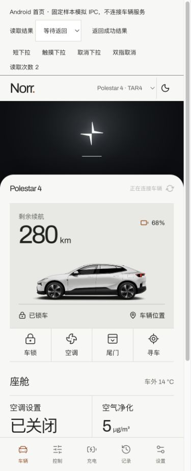
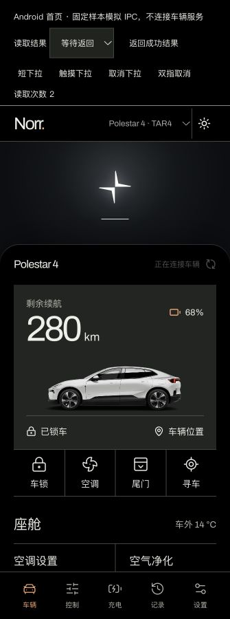
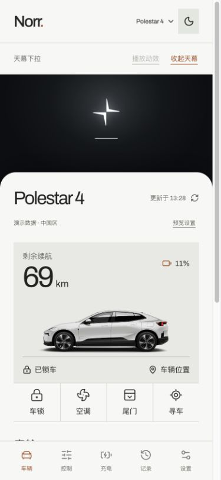
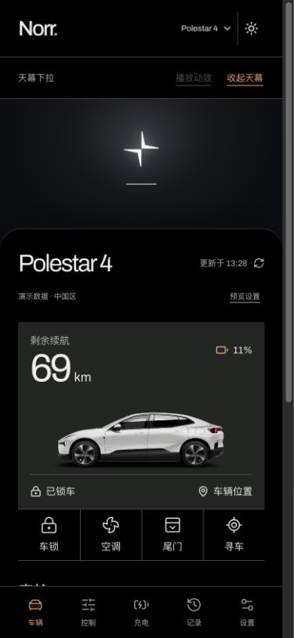
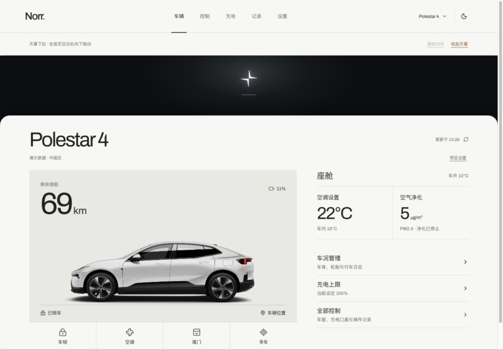

# 首页天幕下拉刷新预览

2026-11-24。基于当前 Web 首页完成设计，并接入共用原生首页；Android 构建与手机安装记录见下方。

运行根目录的 `npm run dev -- --port 5173 --strictPort` 前先检查端口。打开 `http://127.0.0.1:5173/?demo=p4&motion=sky`。

- 在首页顶部的非控件区域向下拖动，松手时揭开高度达到 128px 即触发刷新；不足阈值直接回弹。手势带阻尼，最大揭开高度为 192px。
- “播放动效”自动演示拉开、刷新、完成、收起；“定格展开”停在 172px 供审阅，再点“收起天幕”恢复。这两个预览控件仅在 `motion=sky` 链接显示。
- 下拉与原有刷新按钮调用同一 `workspace.refresh()`。所有车辆数据仍为已有演示数据，未访问凭据或实车。

## 设计依据

设计解读：供车主查看车辆状态的首页，在现有极星视觉语言中增加天幕揭开的刷新手势。ENERGY 2 / RHYTHM 2；本次按用户要求将手势区域提升至 MOTION 2，其余界面维持原有动效。

| 决策 | 原因 |
| --- | --- |
| 炭黑天幕与白色标志 | 呼应用户指定的极星标志与天幕意象，在深浅主题中保持同一刷新焦点。 |
| 保留车图、Archivo 字体和原有页面结构 | 动效结束后车辆读数继续承担首页焦点。 |
| 页面的圆弧上缘与窄阴影 | 表现页面与背后天幕的层次，拉动越远，揭开的边缘越明显。 |
| 仅标志周围发光 | 亮度传达下拉进度，达到阈值时清晰可见。 |
| 短暂呼吸与完成亮起 | 区分刷新中和完成；呼吸最多 4.2 秒，之后静止。 |
| 细进度线 | 提示拉动进度；按用户反馈，天幕内不显示文字，状态通过原有刷新按钮和读屏提示表达。 |

标志复用 [Simple Icons 原始 SVG](https://github.com/simple-icons/simple-icons/blob/develop/icons/polestar.svg)，未重新绘制。来源及 SHA-256 位于 `apps/web/src/assets/brand/manifest.json`。

## 验证记录

浏览器检查在 Codex 内置浏览器进行。下列记录只覆盖本次变更及相邻入口。

| 入口或交互 | 实际结果 |
| --- | --- |
| 播放动效 | 天幕展开，原有按钮显示刷新状态；原有更新时间更新，最后回到 idle。 |
| 定格展开 / 收起天幕 | 展开高度 172px，收起后位移归零。 |
| 短距离鼠标下拉（40px） | 进入回弹，未出现正在更新状态。 |
| 长距离鼠标下拉（360px） | 进入 refreshing，原有刷新按钮显示“正在更新”并禁用，随后恢复。 |
| 键盘 Enter 操作收起按钮 | 天幕收起。按钮复用现有 `:focus-visible` 规则。 |
| 浅色 / 深色切换 | 标志、车图与原有导航均可见；截图见下方。 |
| 车辆 / 控制导航 | 正常切换，预览工具只出现在首页。 |
| 窄屏与桌面 | 内容区 320px、375px、1425px 检查，无新增水平溢出。对应浏览器宽度为 335px、390px、1440px，桌面滚动条占 15px。 |
| 控制台 | 检查时无 error / warn。 |

`npm run build` 通过（包含 TypeScript 检查）；`npm test --workspace @norr/web` 现有 30 项测试通过；`git diff --check` 通过。

代码复核：只有首页、存在车辆、非空场景且无弹窗时接收手势；排除按钮、链接、表单和可滚动子区域；上滑、横向手势、取消和多指触摸不触发刷新。忙碌时防止重复调用。切页、切车和卸载会终止动画等待并移除监听。异常回调显示失败提示后收起。`prefers-reduced-motion` 关闭过渡与呼吸。上述触摸取消、异常回调和系统减少动态效果分支本轮仅做代码复核，没有宣称真机验证。

## 交付门禁

- Hard Gate PASS（本次 Web 预览范围）：新增按钮可操作、演示标识保留、320px 内容区可用、深浅主题可见、标志有来源记录。天幕无可见文字；浅色工具文字对比度 5.47:1，深色工具文字 10.04:1。键盘操作已验证，减少动态效果样式已复核。
- Purpose Gate PASS：天幕、光晕、阴影与进度线均有上表的用途；没有新增装饰卡片或持续背景动画。
- Liveliness PASS：沿用 ENERGY 2 / RHYTHM 2，手势区域 MOTION 2；下拉时以发光极星为焦点，回位后恢复车辆读数的层级。
- Craftsmanship PASS（设计预览）：生产构建、当时的 30 项测试和本表浏览器交互检查通过。Web 刷新函数保持既有模拟语义；后续原生接入记录见下方。

## 原生接入与 Android 安装

同日按用户确认的无文字设计接入 `NativeApp`。下拉与原有刷新按钮共用 `refresh()`，沿用原生 `refresh` IPC、连接恢复、车辆选择、快照合并和历史读取。天幕中只显示极星、光效与细线，播放及定格工具不进入原生应用。

原生刷新返回成功、部分失败、失败或取消；失败不播放成功动效，空结果和全部失败不被当作更新成功。读屏状态区分这些结果。车辆上报时间继续由原始读数提供，完成提示仅代表此次读取完成。新增同步请求锁，避免重复下拉与按钮同时触发重复读取。

自动验证：`npm run build`、前端 31 项测试、`npm run check:native` 的 108 项测试通过。新增测试覆盖完整、部分、全部失败、带旧值的失败、空结果和缺失快照。

浏览器固定样本入口为 `/tests/fixtures/native-refresh.html`，使用 Tauri `mockIPC`，未进入生产构建、未连接真实车辆服务。原生布局在 335px 和 375px 内容宽度检查，深浅主题无水平溢出，天幕文本为空，控制台无 error / warn。

| 固定样本操作 | 结果 |
| --- | --- |
| 初次读取后短下拉、取消、双指取消 | 读取次数保持 1。 |
| 下拉刷新并保持等待，期间再下拉 | 读取次数仅增加至 2，刷新按钮禁用。 |
| 返回成功 | 显示读屏完成提示并回收，未附加“演示”到真实入口文案。 |
| 部分读取失败 | 空调显示未知，动效进入 partial，未误报完整成功。 |
| 连接异常 | 保留缓存并显示原有连接错误，动效进入 error。 |
| 失败后重新下拉 | 重新连接并发起读取。 |
| 请求等待期间切换控制页 | 天幕立即重置 idle；返回结果后没有残留动效。 |
| 点击原有刷新按钮 | 同一 IPC 计数增加，原有行为保留。 |

合成触摸事件覆盖逻辑分支，不代表物理手指或 Android WebView 手感验证。真机下拉手感、账号恢复及实车刷新尚待用户打开应用后实测。

构建复用本机 Homebrew JDK 21、NDK 30、SDK 36。此前默认 Java 27 与 Gradle 不兼容、SDK 下 NDK 26 目录不完整，因此仅为本次构建指定已安装工具链，未修改系统默认环境。

- 安装包：`target/android/Norr_0.1.0-dev.1008_android-arm64-sky-refresh.apk`。
- 标识：`app.norr.mobile`；版本 `0.1.0-dev.1008`，versionCode `1008`；ARM64，最低 Android 7.0，目标 Android 16。
- 大小：49,608,534 字节。
- SHA-256：`b2177e2f181e90413d533b33eab2d0dc6f9e2ea4d5938191caeb47535edcbd72`。
- 沿用本地 Android 测试证书，APK v2 签名验证通过；ZIP 完整性、ZIP 16 KB 页对齐与 ELF LOAD 段 `0x4000` 对齐检查通过。
- 用户连接 vivo V2408A 后，使用 `adb install -r` 成功覆盖版本 `0.1.0-dev.1007`。安装后核对版本为 `1008`，首次安装时间保留，手机 APK 的 SHA-256 与交付包一致。未清除应用数据，未代用户登录或发送车辆操作。

原生交付门禁：

- Hard Gate PASS：无可见天幕文字；模拟样本有明确标识；成功、部分失败、失败、取消和重复操作均有检查记录；深浅主题与窄屏检查通过。
- Purpose Gate PASS：沿用确认的天幕、极星与光效，使用同一原生刷新入口，没有增加车控操作。
- Liveliness PASS：保留 ENERGY 2 / RHYTHM 2，天幕手势 MOTION 2，其余页面沿用既有设计。
- Craftsmanship PASS：构建、31 项前端测试、108 项原生测试、APK 签名与对齐、手机覆盖安装及安装包摘要核对通过。真机交互和实车读取范围明确列为待验。

## 截图

