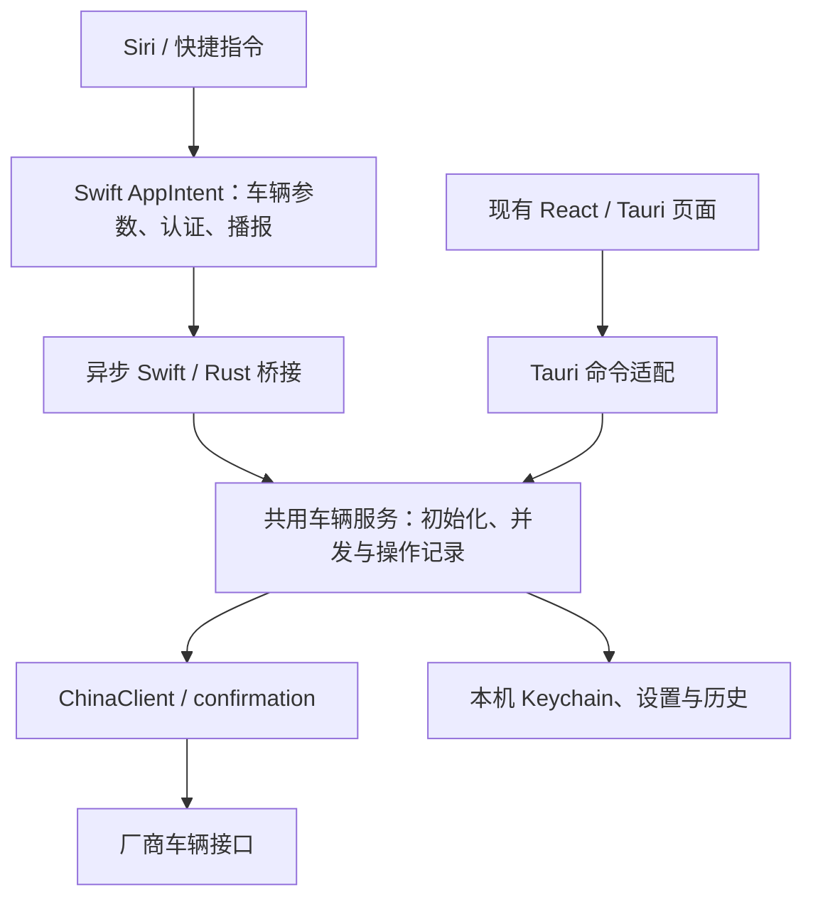

# Siri 接入方案

更新日期：2026-11-18，时区 Asia/Jakarta（UTC+07:00）。评估基线：Norr `2696aa7`。

首期代码已实现并生成测试包。语音短语、后台生命周期和实车行为仍需真机验证。任务状态和已执行检查见[实施任务计划](siri-implementation-plan.md)。

## 目标与工作量

让车主通过 iPhone 的 Siri 查询车辆状态、锁车和启停空调，并在“快捷指令”中使用同一组动作。首期面向当前已接入的中国区 Polestar 2，复用 Rust 车辆核心、登录会话和操作记录。

建议采用 Swift App Intents + App Shortcuts，优先将 Intent 放入 iOS 主 App，通过原生桥接调用不依赖页面的 Rust 服务。核心可测试版预计累计 5～8 人日，完成后台、认证、签名和实车回归后累计 10～15 人日。按一名熟悉 Swift/Rust 的开发者投入，相当于约 2～3 个工作周；等待设备、账号和车辆的时间另计。

主应用的编译、元数据和模拟器启动已验证。后台启动、真实凭据读取及 Siri 语音返回的完整链路仍是首期验收的重点。

## 首期功能

| 动作 | 建议 Intent 名称 | 实际执行与返回 |
| --- | --- | --- |
| 查询电量和续航 | `GetVehicleEnergyIntent` | 读取 `battery`，分别返回可用值、单位和数据时间 |
| 查询门锁状态 | `GetVehicleLockStateIntent` | 读取 `exterior`，区分已锁、未锁和未知 |
| 锁车 | `LockVehicleIntent` | 执行 `lock`，通过新的 `exterior` 回读确认 |
| 开启空调 | `StartVehicleClimateIntent` | 执行 `climateStart`，沿用默认舒适温度路径 |
| 关闭空调 | `StopVehicleClimateIntent` | 执行 `climateStop`，通过新的 `climate` 回读确认 |

首期空调启动不接收自由温度参数。Rust 已有 `value = None` 的默认舒适温度路径，当前编码默认值为 22 °C；不要在 Intent 中硬传 `Some(22)`，否则会触发远程调温能力检查，错误排除只能启停空调的车辆。实际回读温度与动作确认沿用共用核心规则。

首期处理单车默认值与多车消歧。已有快捷指令绑定的车辆失效时，应要求重新选择，不能静默换成另一辆车。查询与车控均按账号、区域、车辆能力和厂商授权判断，保留共享账号的合法控制路径。

后续范围包括解锁、尾门、车窗、自由调温、Apple Watch 本机 Siri、macOS Siri，以及更多车型。HomePod、CarPlay 和跨设备转发需要各自验证。任意自然语言组合任务和 Siri AI 新能力不计入本次首期预算。

## 已有基础与缺口

| 当前实现 | 可复用内容 | Siri 接入缺口 |
| --- | --- | --- |
| [车辆核心 ChinaClient](../../crates/vehicle-core/src/china.rs) | 会话恢复与续期、服务发现、能力校验、单项读取、准备与执行命令 | 冷启动时需要先恢复会话和车队元数据，不能直接依赖页面已连接的状态 |
| [Tauri 宿主](../../apps/native/src-tauri/src/lib.rs) | `Backend`、操作回执、历史存储、通知与局部回读 | `send_command` 接收窗口与 AppHandle，服务初始化与应用启动耦合 |
| [移动端桥接](../../apps/native/src-tauri/src/mobile.rs) | Swift 插件注册、应用数据目录 | 数据目录在插件 setup 中设置，Intent 提前运行时可能尚未就绪 |
| [移动端生命周期](../../apps/native/src-tauri/src/desktop_mobile.rs) | 前后台状态检测 | 当前采集循环在非活动状态跳过工作，不能直接用它保证 Siri 回读 |
| [iOS 凭据存储](../../crates/vehicle-core/src/credentials/ios.rs) | Keychain 会话读写 | 需核对实际条目的锁屏可访问性、升级与重签行为 |
| [命令确认](../../crates/vehicle-core/src/confirmation.rs) | 按 VIN、动作、时间与目标判断回读 | 需把服务回执与车辆确认分别映射成语音结果 |
| [iOS 小组件](../../apps/native/src-tauri/ios/Widgets/NorrWidgets.swift) | App Intents 构建经验和 Widget 配置 | 现有 Intent 用于组件配置，未提供 Siri 车辆动作 |
| [Watch 客户端](../../apps/native/src-tauri/watch/README.md) | Swift 请求、授权同步和待核对记录 | 当前依赖手机更新 access token，不能据此承诺长期独立执行 |

## 执行架构

### 主 App 执行路径

优先在 iOS 主 target 中编译 Intent 与 App Shortcuts 注册代码。Apple 支持主 App 中的 Intent 在前台或后台执行，也支持放入扩展；代码所在 bundle 和运行模式会影响系统调度。[Apple 运行机制](https://developer.apple.com/documentation/appintents/configuring-the-runtime-behavior-of-your-app-intents)

实施时先证明系统能在无前台页面的情况下执行查询。主 App 进程被启动不等于需要展示页面，也不等于可以获得持续后台运行时间。

若 Tauri 生命周期无法满足这一要求，记录具体阻断原因，再评估 App Intents extension。扩展方案会增加共享存储、Keychain access group、进程间协调和嵌套签名工作，需要重新估算。用 URL 打开页面可以作为明确的前台降级入口，但不能作为后台车控验收通过的依据。

### 共用车辆服务与桥接

从宿主中提取初始化、车辆选择、读取、发令和回读服务。保留 `crates/vehicle-core` 中已有厂商协议，Tauri 与 Intent 使用同一个服务实例及存储规则。

- 初始化必须可重入且只完成一次，覆盖 Intent 与页面同时启动。原生数据目录必须与已有 Tauri 目录一致，不能创建第二套账号或历史。
- 在 Swift 到 Rust 的异步桥接中定义请求身份、结果所有权、错误映射和取消语义，不阻塞主线程；不能让页面 JavaScript 代为执行 Intent。
- 页面和 Siri 共用会话续期协调，避免同时刷新令牌及覆盖新会话。凭据留在 Keychain，不放入快捷指令参数、URL、Widget 快照或日志。
- 首期沿用已有全局串行策略控制车辆操作；并发请求应明确等待或返回忙碌状态，不同时创建多个可写 `Backend`。
- 验证元数据加载顺序。当前 `validate_command` 依赖已知车队，冷启动必须先完成连接与授权恢复，再按最新车辆能力校验。
- 事件发送和通知作为宿主适配处理，车辆服务完成动作不应要求存在 `WebviewWindow`。

实施文件与职责如下。

| 位置 | 调整内容 |
| --- | --- |
| `apps/native/src-tauri/src/vehicle_service.rs` | 从 `lib.rs` 提取服务与状态协调，保留原有历史兼容性 |
| `apps/native/src-tauri/src/siri.rs` | iOS 原生调用入口、异步桥接和受限动作集合 |
| `apps/native/src-tauri/gen/apple/Sources/norr/Siri/` | Intent、VehicleEntity、AppShortcutsProvider 和中文资源 |
| `apps/native/src-tauri/src/lib.rs` | Tauri 页面接入共用服务，并核对与 Intent 使用同一应用数据目录 |
| `apps/native/src-tauri/gen/apple/project.yml` | 编译 Swift 文件和 App Intents 元数据，并同步生成的 Xcode 工程 |
| `apps/native/scripts/finalize-ios.mjs` | 验证最终产物的 Intent 元数据、注册入口与签名结构 |

### 车辆参数与中文短语

用 `VehicleEntity` 表示可操作车辆，实体身份按账号与 VIN 隔离，显示名称使用车型或用户可识别的车辆名称。每次执行都重新检查实体是否属于当前账号；快捷指令保留的标识不能代替授权判断。

显式选择的车辆优先。参数省略时，使用仍属于当前账号的有效默认车辆；只有一辆车时可使用该车。多车且没有有效默认值时让系统询问。请求开始后固定车辆和账号，执行期间切车或切账号时重新校验，不把结果写入新账号。

App Shortcuts 提供带应用名称的短语，示例为“用北行查看车辆电量”“用北行锁车”“用北行开启空调”。实际代码使用 `.applicationName`，配置并验证 `Norr / 北行` 名称与中文本地化；这些示例尚未通过语音识别验收。Apple 的 App Shortcuts 可自动提供快捷动作，其触发短语需要包含应用名称占位符。[App Shortcuts 官方介绍](https://developer.apple.com/videos/play/wwdc2025/244/)

### 认证与锁屏

首期所有动作使用本机认证的 Intent 策略，车控提交前再要求确认。查询可在系统已满足认证条件时执行；不以“请求来自 Siri”替代车辆服务的账号授权。

`requiresLocalDeviceAuthentication` 要求执行 Intent 的设备满足系统认证条件。系统会根据设备状态决定是否提示解锁。未来引入解锁或尾门动作时，仍要保留应用内现有的敏感操作保护。[Apple 认证策略](https://developer.apple.com/documentation/appintents/intentauthenticationpolicy)

P0 先读实际 Keychain 属性，并验证锁屏、重启后首次解锁前后和授权过期场景。不要为追求锁屏可用直接放宽全部凭据保护。凭据或文件不可访问时返回需要解锁或打开 Norr 的说明；系统暂时锁定不能被解释成退出登录，也不能清空已有凭据。

### 结果、超时与恢复

查询调用单项读取接口，电量与续航不需要刷新全部 14 类数据。每项结果保留车辆上报时间和本机读取时间；本次请求成功不代表车辆刚刚上报。首期查询失败时返回原因。后续若接入同账号同车缓存，需明确标注缓存及其时间。缺失值保持未知，不能显示为 0 或已锁车。

命令使用显式动作，避免“切换门锁”“切换空调”这类依赖旧状态的开关。

1. 解析车辆，完成认证、用户确认与当前能力检查。
2. 创建并持久化请求身份、账号、VIN、动作与发送时间，持久化失败则不发令。
3. 提交一次车辆指令，分别记录厂商回执和车辆回读结果。
4. 在本次 Intent 可用执行时间内进行有限的局部回读，复用 `confirmation` 的时间与状态规则。
5. 尚未获得足够新证据时保存待核对记录并返回；下一次系统运行机会或用户打开应用时继续只读核对。

| 结果 | 建议语音表达 | 判定要求 |
| --- | --- | --- |
| 查询成功 | “电量为实际读数，车辆数据更新于实际时间。” | 按返回值生成，不使用固定样例冒充实测 |
| 车辆已确认 | “车辆已锁好。”或“空调已开启。” | 目标车辆的新回读满足共用确认规则 |
| 服务已受理 | “请求已受理，车辆状态仍待确认。” | 仅有服务回执，尚未完成独立回读 |
| 发送结果不明 | “暂时无法确认结果，请核对车辆状态。” | 请求可能已经到达车辆，不能表述为肯定未执行 |
| 明确拒绝 | “车辆未接受请求。”并附可解释原因 | 有明确拒绝证据 |
| 未发令 | “身份验证未完成，指令尚未发送。” | 认证、确认或发送前校验中止 |

网络超时、用户取消等待或系统终止均不能推导出车辆指令已撤销。提交后的操作保留待核对状态，不自动重发；重复调用同车同一目标时先核对未决操作。相反动作也要明确处理冲突，避免隐式覆盖。

每次桥接调用使用 17 秒的请求预算，提交后最多在剩余预算内回读两次。该值用于限制应用等待时间。后台调度和车端上报时间将在真机验收中记录。系统允许的运行时间因版本和场景而异，不将较新系统的长任务能力作为 iOS 16 基线前提。

## 系统版本、安装与分发

App Intents 基础框架从 iOS 16、macOS 13、watchOS 9 起提供。Norr 主 App 当前最低为 iOS 15，小组件为 iOS 17，Watch 为 watchOS 10。[Apple 平台可用性](https://developer.apple.com/documentation/appintents)

保留主 App 的 iOS 15 兼容目标，通过可用性检查限制 Siri 功能。`supportedModes` 等较新接口必须检查各自版本，较早系统使用其可用的执行配置。最低支持版本和当前系统分别测试，不能仅凭最新模拟器编译成功宣称 iOS 16 已通过。

最终包需检查 Swift 静态链接、Intent 元数据抽取、App Shortcuts 注册和本地化。Norr 曾出现桥接入口被静态链接丢弃的问题，应在实际 IPA 上检查。新增 entitlement 或扩展前核对具体执行方案需要的权限，不照搬旧 SiriKit 的配置。

沿用[当前自助签名流程](../ios-self-signing.md)，验收 AltStore 重签后的动作发现、执行、覆盖升级与会话保留。unsigned IPA 构建通过不能替代真机安装和 Siri 验证。长周期续签尚未覆盖时在发布记录中明确标注。

## 风险与后续范围

| 风险 | 对策与决策点 |
| --- | --- |
| Intent 冷启动早于 Tauri 初始化 | P0 验证最小调用链，拆分目录及服务初始化；必要时重新评估扩展方案 |
| 锁屏凭据或文件不可读 | 保留凭据，返回解锁指引；按实际属性决定兼容策略 |
| 车辆响应晚于 Intent 生命周期 | 提前持久化记录，区分受理与完成，恢复后只读核对 |
| 页面与 Siri 同时刷新或控制 | 共用会话和服务锁，覆盖账号变化、重复请求与冲突操作 |
| 元数据或签名改变动作发现 | 对最终 IPA 与重签设备验收，记录实际 bundle 标识及版本 |
| 设备或实车无法配合 | 保留未验证状态，不将模拟请求替代实车结果；等待时间不计入人日 |

Watch 本机 Siri 额外初估 3～5 人日，前提是保留目前由手机补充授权的模式，并有配对真机。需要从 `WatchRemoteClient` 分离 UI 状态和请求执行，验证 Watch 的认证、后台和结果播报。长期脱离手机的续期另立方案。

macOS 可复用 Intent 模型与 Rust 服务，但主宿主、Keychain、元数据打包和系统调度需要单独验证，待 iPhone P0 结果后估算。

## 交付检查

- Hard Gate PASS。文档标明实现与验收边界。打包脚本从最终产物核对五个动作及其认证策略。
- Purpose Gate PASS。五个动作对应首期车辆需求，共用 Rust 执行和回读规则。控制短语触发系统确认后才进入发令流程。
- Liveliness PASS。播报使用 Norr 现有的门锁、空调和待核对术语。此次新增内容在 Siri 和快捷指令的系统界面呈现。
- Craftsmanship PASS。Rust 工作区和桥接样本通过，两个 iOS 包通过构建及产物检查。实际语音调用和实车验证在任务计划中列为待验收。
